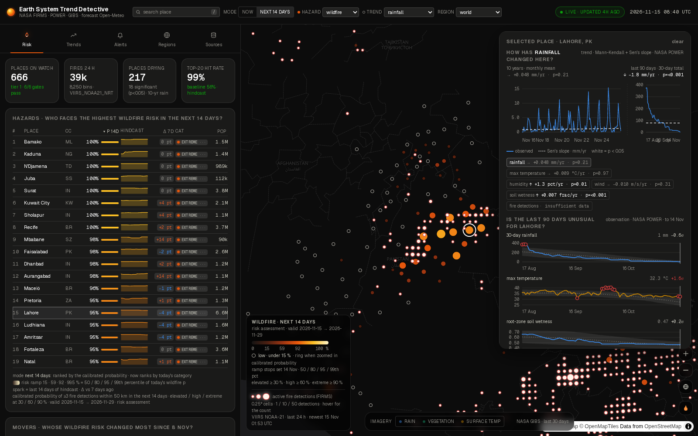

# Earth System Trend Detective

**Detect the trend. Predict the hazard. Explain both.**

NASA Space Apps 2026 · challenge "Be an Earth System Trend Detective".

A live globe that watches 666 places: 554 capitals and large cities on every continent, plus 112 districts of Pakistan. For each it asks NASA's record two questions. First, what is changing here, and how fast? Every place gets a 10-year and a 90-day trend for rainfall, temperature, humidity, wind, soil wetness and fires, each a slope in real units with a significance test. Second, so what happens in the next 14 days? Four hazard modules turn those trends and the weather forecast into wildfire, drought, heat and heavy-rain risk. Probability, severity, exposure and confidence are shown side by side and never merged into one score. A pipeline rebuilds everything every three hours and publishes only if seven automatic checks pass. There is no server, no paid service, and no human in the loop.

**Live:** **https://globalalert.earth** · try `?place=lahore-pk`, or type your own city in the search box.



---

## What is changing, where, how much, and so what

| Question | How the site answers it |
|---|---|
| **What is changing?** | The trend engine runs a Mann-Kendall test with Sen's slope for every place and every variable, over two windows: **10 years of monthly means** ("how much has it changed") and **the last 90 days of daily values** ("what is changing now"). Each result is a slope in units per year, a p-value, and a label: rising, falling or stable (significant at p < 0.05), or insufficient data. |
| **Where?** | Every place is a point on the globe, coloured by its slope in the trend lens. The trends table ranks the strongest changes; a region filter narrows to one continent or Pakistan. |
| **How much?** | The slope is in real units (mm/yr, °C/yr, soil-wetness fraction/yr). The place panel draws the 10-year series with its Sen's slope line, and the last 90 days against the place's own normal band. In run `20261115T0417Z`, 72 places show significant 10-year warming and none show significant cooling. Root-zone soil wetness is falling at 113 places. |
| **So what?** | One feature table per place per day feeds four hazard modules for the next 14 days, listed below. |

| Hazard | Method | Headline number |
|---|---|---|
| **Wildfire** | XGBoost trained on 12 months of FIRMS detections. The label is "≥ 3 detections within the place's radius in the next 14 days". Training uses a time-ordered split, the final six weeks are held out, and the output is isotonically calibrated. On the held-out weeks: PR-AUC **0.785** against **0.303** for a fire-weather-index baseline, Brier score 0.124 against 0.206. SHAP values name the top drivers for each place. | calibrated probability |
| **Drought** | 30- and 90-day rainfall deficit against the place's normal, soil-wetness anomaly and the trend slope, combined into a standardised index | index and category |
| **Heat** | Forecast maximum temperature against the place's own 95th and 99th percentiles | days above, and category |
| **Heavy rain** | Forecast 3- and 7-day totals against the place's own percentiles | probability of an unusually wet week (*not a flood forecast*) |

Thresholds come from each place's own record, so "unusual" means unusual *for that place*. Each hazard card shows probability or index, severity, exposure (population within the radius), confidence (high, medium, low), drivers, and one templated sentence. No generative AI produces any number or sentence on the site.

## Data sources

Every panel labels its numbers as one of four kinds: **observation**, **forecast**, **trend** or **risk assessment**. The site never mixes them.

| Source | Used for | Latency | Kind |
|---|---|---|---|
| [NASA FIRMS](https://firms.modaps.eosdis.nasa.gov/): VIIRS NOAA-21 NRT (live layer), MODIS NRT (counts), MODIS SP (12-month history) | fires on the globe, detections per place, wildfire labels | ~3 h | observation |
| [NASA POWER](https://power.larc.nasa.gov/) daily point API (T2M, T2M_MAX, PRECTOTCORR, RH2M, WS2M, GWETROOT, GWETTOP) | 10 years of daily weather per place, every trend, anomaly series, model features. Its precipitation is derived from GPM IMERG. | ~3 days | observation |
| [NASA GIBS](https://gibs.earthdata.nasa.gov/) WMTS (IMERG rain rate, MODIS NDVI, MODIS land surface temperature) | imagery layers on the globe, with a 30-day date slider | ~1 day | observation |
| [Open-Meteo](https://open-meteo.com/) 16-day forecast (**non-NASA supplement**) | the forward-looking inputs to the hazard modules | refreshed every ≤ 6 h | forecast |
| [Natural Earth](https://www.naturalearthdata.com/) populated places; [GADM 4.1](https://gadm.org/) districts with 2017 census population | the place list and exposure | static | reference |
| Our trend engine (Mann-Kendall + Sen's slope) | `trends.json` | every run | **trend** |
| Our hazard modules | `risk.json`, `feed.json` | every run | **risk assessment** |

Open-Meteo, the only non-NASA feed, is labelled "non-NASA supplement" wherever it appears. The freshness panel shows every source's valid time, retrieval time and status.

## How the cron works

`.github/workflows/pipeline.yml` runs on GitHub Actions every three hours (`0 */3 * * *`) and can also be started by hand.

1. **Restore** caches and previous outputs from the orphan `data` branch, so the 10-year POWER history is fetched only once.
2. **Ingest**: FIRMS world tiles, POWER from each place's last cached day (paced at 1 request per second), and the Open-Meteo forecast (reused for up to 5.5 h to respect its per-IP quota).
3. **Trend**, **features**, **hazards** (the wildfire model retrains in seconds every run), then **publish** nine JSON files.
4. **Gates.** `run.py` grades the run and writes `run.json`. If any stage or gate fails, the run exits non-zero and nothing is pushed or deployed, so the site only ever shows a run that passed.
5. On success, force-push `cache/` and `out/` to the `data` branch, check G7, and trigger the Pages deploy.

The dashboard is a Next.js static export. It reads the JSON straight from the `data` branch through a 5-minute cache-buster.

| Gate | Passes when |
|---|---|
| **G1 Time** | an incremental run takes < 20 min (a cold run < 60 min) |
| **G2 Coverage** | ≥ 98 % of places have POWER through 4 days ago, a complete 14-day forecast, and a FIRMS count |
| **G3 Freshness** | FIRMS ≤ 6 h old, POWER ≤ 4 days, forecast ≤ 12 h |
| **G4 Sanity** | FIRMS > 1,000 rows; every risk in [0, 1]; no NaN; spread of risk across places > 0.01; trend p-values in [0, 1] |
| **G5 Model** | held-out PR-AUC beats the fire-weather baseline, and the Brier score is at or below it |
| **G6 Output** | every JSON < 5 MB, and `generated_at` newer than the previous run |
| **G7 Deploy** | the live `run.json` on the `data` branch returns the new run id |

Each gate records its value and a one-line detail in `run.json`.

## The honesty panel

This panel checks the model against what the satellites then saw. Per probability bucket it draws the **predicted** wildfire probability beside the **observed** share of places that burned; a calibrated model has matching bars. The headline is the **top-20 hit rate**: of the 20 places ranked riskiest on a day, the share that then had ≥ 3 detections, against the same figure for the fire-weather-index baseline.

A badge shows which of two modes the panel is in:

- **held-out hindcast** (amber, today's mode): the six weeks the model never trained on (20 Sep to 31 Oct 2026). Top-20 hit rate **99 %** against **56 %** for the baseline.
- **published** (green): every green run stores the risk it published in `cache/published/`. Once that store is two weeks old, the panel scores those real forecasts against the detections that followed.

A row of dots shows the last ten runs and their durations.

## Known limitations

- **POWER lags about 3 days.** "Now" in the trend and anomaly charts means three days ago. Its newest ~6 weeks switch from MERRA-2 to GEOS, a step in soil wetness, wind and humidity that `trend/load.py` detects and removes each run.
- **Wildfire labels cover only 12 months.** The model has seen one fire season, and the 10-year fire trend reads "insufficient data" everywhere. Fires also persist, so the hit rate in the burning belts partly reflects where fires already are (the label's base rate is 0.29).
- **Perfect-prognosis training.** In training, the forecast slots are filled with POWER's *observed* next 14 days. At inference they come from Open-Meteo's forecast, which is less accurate. The held-out skill is therefore an upper bound until the published mode has two weeks of real forecasts to score. The honesty caption says so.
- **No flood modelling.** Heavy rain is "an unusually wet week for this place", not inundation. There is no terrain, river routing or GloFAS.
- **Points, not areas.** Each place is a 50 km radius (30 km for Pakistan districts) around one coordinate, with population as its only exposure layer.
- The honesty ledger lists only green runs, because a failed run publishes nothing. The layout is built for a laptop screen.

## Safety statement

Earth System Trend Detective is an informational and research tool. It is **not an official warning service**. Its risk assessments are statistical estimates and can be wrong. In an emergency, follow your national meteorological service and local authorities.

## Run it from a clean clone

You need Node 22+, [uv](https://docs.astral.sh/uv/) and Python 3.12.

```bash
git clone https://github.com/uzainmalik123/nasa-proj.git && cd nasa-proj

# Dashboard against the live data (http://localhost:3000)
cd dashboard && npm ci
NEXT_PUBLIC_DATA_URL=https://raw.githubusercontent.com/uzainmalik123/nasa-proj/data/out npm run dev
# leave NEXT_PUBLIC_DATA_URL unset to use the mock files in public/data/
cd ..

# Pipeline
cd pipeline && uv sync
uv run pytest -q && uv run ruff check .
cp .env.example .env               # add a free FIRMS MAP_KEY: https://firms.modaps.eosdis.nasa.gov/api/map_key/
uv run python run.py               # writes data/out/*.json
```

A cold run takes 40–60 minutes, mostly the one-time 10-year POWER history and the quota-paced 12-month FIRMS backfill. To start warm, restore the CI cache first (about 140 MB):

```bash
git fetch --depth=1 origin data && mkdir -p pipeline/data
git --work-tree=pipeline/data checkout origin/data -- cache out places.parquet && git reset -q
```

Layout: `pipeline/` (Python stages, `run.py`), `dashboard/` (Next.js, MapLibre, d3), `.github/workflows/`, `docs/` (PRD, design, frozen data contracts).
