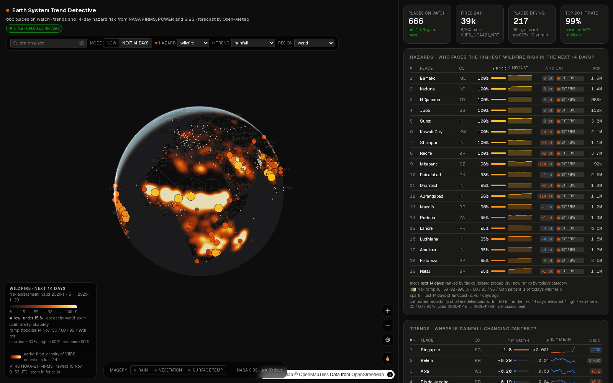
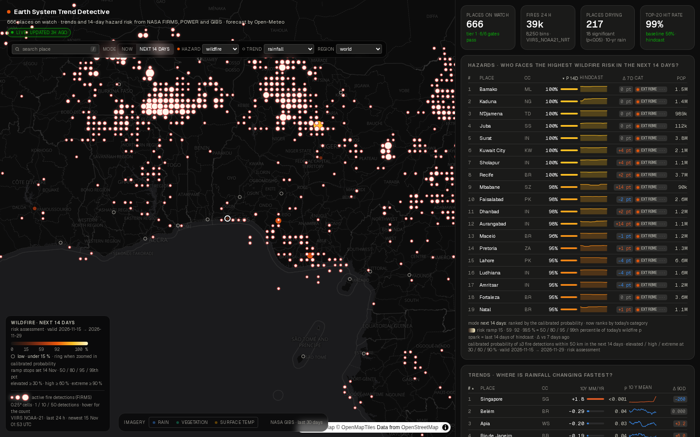
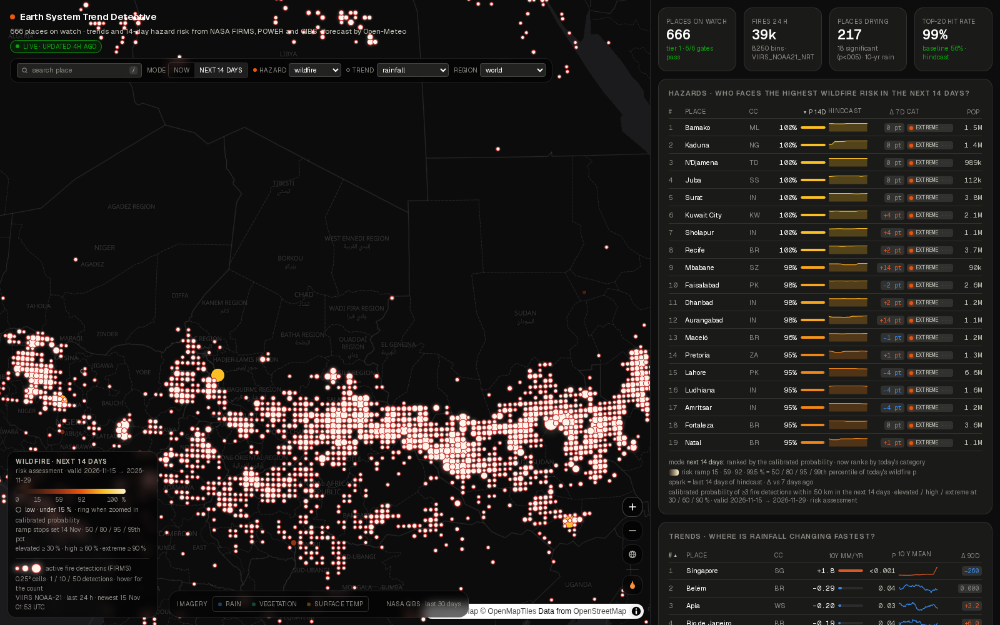
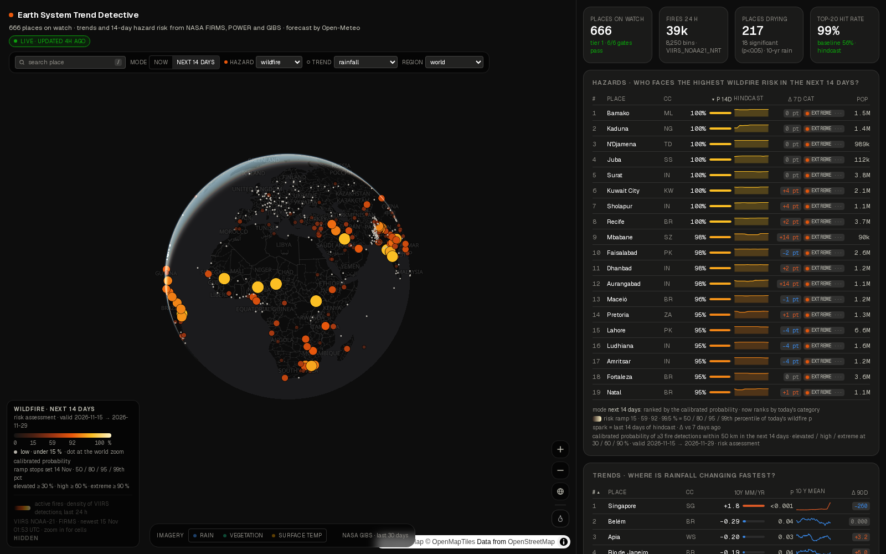

# F1 · fire heatmap at world zoom (handback)

Branch `f1-fire-heatmap`, off `origin/main`. Spec: `docs/superpowers/specs/2026-11-15-dashboard-layout-design.md` §6.1 band 1.

## What changed

**A · heatmap + crossfade + legend swap** (`globe/fires.ts`, `globe/Globe.tsx`, `globe/Legend.tsx`)
- New `fires-heat` MapLibre `heatmap` layer on the existing `fires` source. Paint lives in `FIRE_HEAT_PAINT` (fires.ts):
  weight `min(count, 60) / 60`, radius 18 px at z2 → 28 px at z4, intensity 1, colour transparent → `#9a3412` →
  `#ea580c` → `#fbbf24` → `#fef3c7`, opacity 0.9 at z ≤ 2.5 → 0 at z 4.5.
- Inserted under the `places` layer, so it sits under the fire glow and dots as specified and also under the
  hazard place dots (they stay readable over the glow).
- Glow and dot layers fade in the opposite direction (`fadeInDots`): `circle-opacity` and `circle-stroke-opacity` 0 at z2.5 →
  their existing values (glow 0.18, dot 1) at z4.5. At z ≥ 4.5 the dots and their hover tooltip work exactly as before.
  The tooltip still hit-tests only the dot layer.
- Legend fire row: below z4 it shows a ramp swatch and "active fires · density of VIIRS detections, last 24 h". At z ≥ 4
  it shows the three sample dots as before. The globe's existing quarter-step `zoom` state drives the swap.

**B · map controls** (`globe/MapControls.tsx`, new): a glass stack at the bottom right with `+`, `−`, reset view (flies to
`[20, 15]` at z 1.6, the same values the map is created with), a divider, then a flame toggle. All are real `<button>`s with
`aria-label`, 32 px, `bg-black/60 border border-white/10 backdrop-blur rounded-xl`, inline SVG icons. The flame has
`aria-pressed`. `firesOn` is view state inside Globe (Dashboard.tsx is unchanged) and sets `visibility` on the heat, glow and
dot layers. When fires are off, the legend fire row dims to 40 % and reads "HIDDEN".

**C · KI-19 wording**: the legend now says "ramp stops set 14 Nov · 50 / 80 / 95 / 99th pct" instead of "today's".

## Verification

- `npm run build`: passes. `npm test`: 15/15 pass.
- Screenshots: playwright + headless Chromium (swiftshader), 1600 × 1000, against `python3 -m http.server` serving
  `dashboard/out`. The nine live data files were copied from the `data` branch over `out/data/` first, because the
  local build's `/data` holds only the 20-place mock. Production config is unchanged.

| Shot | What it shows |
|---|---|
|  `f1/world-heatmap.png` | World view, z 1.6: smooth orange-to-cream glow over the Sahel, southern Africa and South Asia with no dot grid. The legend shows the heat ramp row, and the control stack sits bottom right. |
|  `f1/zoomed-dots.png` | `?place=lagos-ng` (fly-to z 5.2): the 0.25° fire dots with red strokes, unchanged. No heatmap is visible, and the legend is back to the three sample dots. |
|  `f1/zoom-buttons.png` | Three clicks on `+` from the world view (about z 4.6): the dots have fully replaced the heatmap, and the legend shows the dots. The script then clicks reset and the legend returns to `heat`. |
|  `f1/fires-off.png` | After clicking the flame: no heat, glow or dots. The legend fire row is at 40 % with "HIDDEN". |

The first headless capture with the bare `chromium --screenshot` command showed a black globe at world zoom because the
virtual-time capture fired before the first globe render. The playwright capture waits 15 s of real time and renders correctly.
